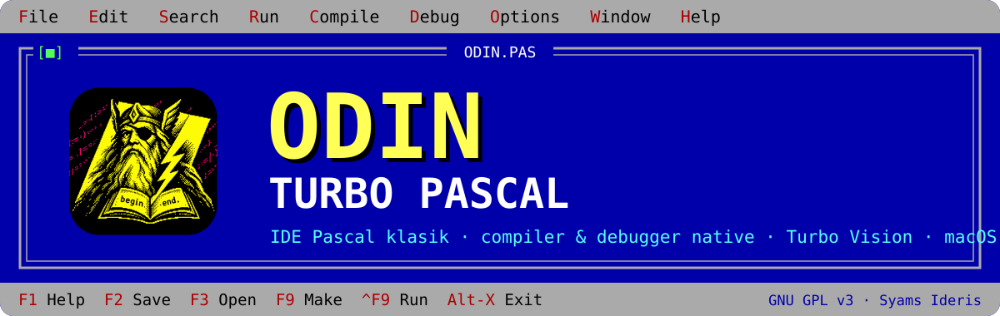
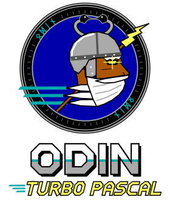
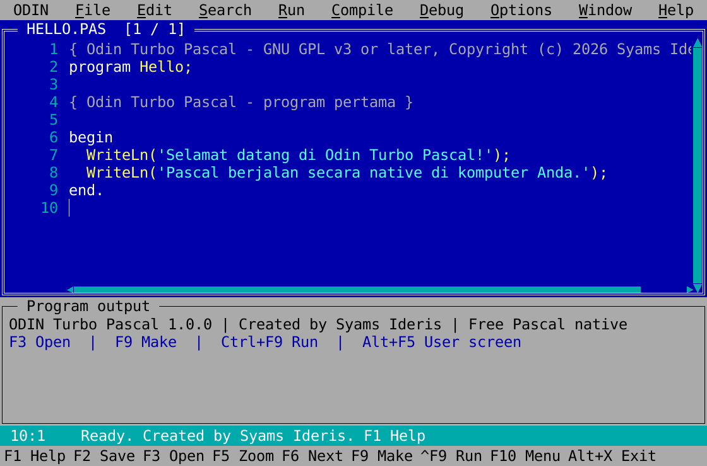

<div align="center">



# Odin Turbo Pascal

**Layar biru Turbo Pascal yang Anda kenal, dengan compiler dan debugger yang menghasilkan program native.**

[](CHANGELOG.md)
[](https://github.com/Syamsuddin/ODIN-TURBO-PASCAL/actions/workflows/ci.yml)
[](LICENSE)
[](#privasi-dan-lokasi-data)
<br>
[](#macos)
[](#linux)
[](#windows)
[](#persyaratan-sistem)
[](#pengembangan)

[Instalasi](#instalasi) · [Mulai Cepat](#mulai-cepat) · [Fitur](#fitur) · [Dokumentasi](#dokumentasi) · [Changelog](CHANGELOG.md) · [Kontribusi](#kontribusi)

</div>

> [!IMPORTANT]
> **Rilis 2.3.0** menyertakan buku tutorial berwarna penuh, *Belajar Pemrograman Bahasa Pascal dengan ODIN Turbo Pascal*, yang dibuka dari menu **Help › Buku**, tutorial 20 bab di **File › Examples**, dan warna sintaks Turbo Biru Lembut. IDE, toolchain Odin, debugger terpadu, dan Odin Vision berjalan di macOS (Intel dan Apple Silicon), Linux (x86_64 dan arm64), dan **Windows** (x86_64). Windows, Apple Silicon, dan Linux diuji di runner GitHub Actions, belum di perangkat fisik pengembang. Lihat [Riwayat Rilis](#riwayat-rilis) dan [Status Pengujian](#status-pengujian).

## Daftar Isi

- [Tentang](#tentang)
- [Fitur](#fitur)
- [Platform yang Didukung](#platform-yang-didukung)
- [Persyaratan Sistem](#persyaratan-sistem)
- [Instalasi](#instalasi)
- [Mulai Cepat](#mulai-cepat)
- [Tutorial Pascal](#tutorial-pascal)
- [Pintasan Keyboard](#pintasan-keyboard)
- [Kompatibilitas](#kompatibilitas)
- [Status Pengujian](#status-pengujian)
- [Privasi dan Lokasi Data](#privasi-dan-lokasi-data)
- [Dokumentasi](#dokumentasi)
- [Pengembangan](#pengembangan)
- [Riwayat Rilis](#riwayat-rilis)
- [Kontribusi](#kontribusi)
- [Lisensi](#lisensi)
- [Penulis](#penulis)

## Tentang



**Odin Turbo Pascal** adalah IDE Pascal yang menghadirkan kembali pengalaman Turbo Pascal era DOS: layar biru, teks kuning, menu abu-abu, jendela editor berbingkai, dan tombol fungsi klasik. Bedanya, kode Anda dikompilasi menjadi **program native untuk macOS, Linux, atau Windows**, tanpa emulator DOS. Setelah terpasang, Odin tidak memerlukan internet dan tidak mengirim telemetri.

Odin punya dua backend compiler:

- **Odin native.** Toolchain Odin sendiri: compiler Pascal, assembler, linker, runtime library, Odin Vision (Turbo Vision milik Odin), dan debugger, semuanya ditulis dari nol. Backend ini bawaan di macOS (Intel dan Apple Silicon), Linux (x86_64 dan arm64), dan Windows (x86_64).
- **Free Pascal.** Compiler yang dipakai rilis 1.0.0. Tetap bisa dipilih di **Options › Compiler**, dan dipakai otomatis di sistem yang belum didukung backend Odin.

Odin cocok untuk siswa dan mahasiswa yang belajar algoritma dan pemrograman, guru yang mengajar Pascal di kelas, dan siapa saja yang rindu menekan `Ctrl+F9` lalu melihat programnya berjalan.

<div align="center">



<sub>Editor dengan contoh <code>HELLO.PAS</code> dari rilis 2.2.0 (kini halaman bawaannya <code>bab01_01_halo_dunia.pas</code>). Tangkapan layar dari lingkungan uji Linux; di macOS jendela memakai tampilan Tk native.</sub>

</div>

### Mengapa Odin?

- **Nostalgia yang benar-benar bekerja.** Alur kerja Turbo Pascal tetap utuh: `F2` simpan, `F9` make, `Ctrl+F9` jalankan, `Alt+F5` User screen, `F7`/`F8` menelusuri program baris demi baris.
- **Program native, bukan emulasi.** Hasil kompilasi adalah executable asli untuk CPU dan sistem operasi Anda, dan bisa diekspor untuk dijalankan di luar IDE.
- **Compiler dan debugger milik sendiri.** Di macOS, Linux, dan Windows, Odin mengompilasi dengan toolchain yang ditulis dari nol dan men-debug tanpa LLDB atau GDB, dengan jendela Watches dan Call stack seperti Turbo Pascal.
- **Program interaktif sungguhan.** `ReadLn`, `ReadKey`, warna `Crt`, dan `GotoXY` berjalan di User screen 80×25. Aplikasi Turbo Vision juga berjalan di sana, lengkap dengan mouse, baik dengan Odin Vision maupun dengan Free Vision.
- **Siap untuk kelas.** Ada sebelas contoh program berbahasa Indonesia, referensi Pascal ringkas, dan daftar pesan compiler yang langsung melompat ke baris yang salah.
- **Aman untuk berkas Anda.** Penyimpanan atomik, deteksi perubahan dari luar, dan pemulihan sesi otomatis setiap 10 detik.
- **Ringan, terbuka, dan privat.** Source yang mudah dipelajari dan diubah, berlisensi GNU GPL v3, tanpa akun, server, API key, atau telemetri.

<details>
<summary><strong>English summary</strong></summary>

Odin Turbo Pascal is a DOS-era, Turbo Pascal–style IDE for macOS, Linux and Windows. Programs compile into native binaries and run in a built-in 80×25 terminal with Crt and Turbo Vision support, including the mouse. Odin's own toolchain, written from scratch in Rust and Pascal (compiler with x86-64 and AArch64 code generators, assembler, Mach-O, ELF and PE linkers, runtime library, Odin Vision, and an integrated Turbo Pascal–style debugger with Watches, Locals and Call stack windows), is the default backend on Intel and Apple Silicon Macs and on x86_64 and arm64 Linux since release 2.1.0-alpha.1, and on x86_64 Windows since 2.2.0; Apple Silicon, Linux and Windows are verified on GitHub Actions runners. Free Pascal remains available as an alternative backend. Messages and documentation are in Indonesian. Licensed under the GNU GPL v3 or later.

</details>

## Fitur

### Antarmuka dan editor

- Layar biru klasik dengan menu **File · Edit · Search · Run · Compile · Debug · Options · Window · Help**, status bar, dan baris tombol fungsi.
- Beberapa jendela sekaligus: tile, cascade, zoom, dan daftar jendela.
- Undo/redo, clipboard, find/replace, go to line, hapus baris, indentasi otomatis, serta mode insert/overwrite.
- Warna sintaks **Turbo Biru Lembut** (latar biru tua dengan warna pastel) aktif secara bawaan dan membedakan kata tercadang, variabel, prosedur/fungsi, tipe bawaan, konstanta, angka, string, operator, komentar, dan direktif kompiler. Teks kuning klasik di latar biru tetap tersedia lewat **Options › Editor**.
- Desktop menampilkan logo Odin dengan plakat bergaya dialog Turbo Vision di bawahnya: tag versi (misalnya `v2.2.0`), kredit penulis, hak cipta, dan lisensi. Tag yang sama tampil di baris status, About, dan halaman bawaan `bab01_01_halo_dunia.pas`.
- Encoding CP437 dan UTF-8 (termasuk BOM), serta akhir baris LF dan CRLF, dipertahankan apa adanya saat menyimpan.

### Kompilasi

- Pilihan backend di **Options › Compiler**:
  - **Odin native** *(bawaan di macOS, Linux, dan Windows)*. Bahasa Turbo Pascal 7, termasuk tipe `object`, dengan unit standar dan Turbo Vision (lihat [Unit standar](#unit-standar-turbo-pascal)). Tidak memerlukan Free Pascal, Xcode, maupun GCC. Menghasilkan program x86_64 dan arm64 untuk CPU Anda (di Windows: x86_64).
  - **Free Pascal** dengan mode **Turbo Pascal 7** (`-Mtp`), Object Pascal, atau Delphi.
- Compile, Make, dan Build. Tersedia *primary file* untuk proyek yang terdiri dari program dan unit.
- Unit path dan include path, range check, dan overflow check.
- Daftar diagnostik compiler: klik untuk melompat ke baris error, dan `Alt+F8` untuk pesan berikutnya. Pesan backend Odin berbahasa Indonesia dengan nomor galat gaya Turbo Pascal 7.
- Hasil build disimpan terpisah di cache. Build yang gagal tidak pernah menjalankan executable lama.
- Ekspor executable native.

### Menjalankan program

- User screen 80×25 berbasis pseudo-terminal (ConPTY di Windows): `ReadLn`, `ReadKey`, `KeyPressed`, 16 warna, `GotoXY`, `ClrScr`, dan `Window`.
- Tombol `F1`–`F12`, `Insert`, dan panah diteruskan ke program dengan kode scan Turbo Pascal, termasuk kombinasi Shift, Ctrl, dan Alt (Option di Mac).
- Program Turbo Vision menerima klik, seret, dan roda mouse. Setelah program selesai, isi layar sebelumnya kembali.
- Parameter program (**Run › Parameters**) diteruskan tanpa melewati shell.
- `Ctrl+C` menginterupsi program, `Ctrl+F2` menghentikannya, dan **Copy screen** menyalin isi layar.
- Runtime error (backend Odin): baris penyebabnya ditandai merah di editor, dan **Search › Find error** kembali ke baris itu.

### Turbo Vision (Odin Vision)

Odin Vision adalah Turbo Vision milik Odin untuk backend Odin (macOS, Linux, dan Windows), ditulis ulang dari nol (*clean-room*) mengikuti API Turbo Vision di Turbo Pascal 7:

- Unit `App`, `Drivers`, `Views`, `Menus`, `Dialogs`, `MsgBox`, `StdDlg`, `Memory`, `HistList`, `Validate`, `Editors`, dan `Outline`.
- Jendela bertumpuk dengan bayangan, menu bar dan menu drop-down, serta status line.
- Dialog dengan tombol, input line (dengan validator dan riwayat), check box, radio button, dan list box, ditambah dialog berkas dan dialog ganti direktori.
- Editor teks dan outline.
- Keyboard dan mouse di User screen. Perilakunya dijelaskan di [`rtl/vision/SPEC.md`](rtl/vision/SPEC.md).
- Program demo (menu, jendela editor, dialog, MessageBox) ada di repositori source: [`tests/pascal/vision/VISION.PAS`](tests/pascal/vision/VISION.PAS). Buka dengan **File › Open**, lalu tekan `Ctrl+F9`.

### Debugger

Debugger terpadu bergaya Turbo Pascal untuk backend Odin (macOS, Linux, dan Windows), tanpa LLDB atau GDB:

- **Breakpoint** dari gutter atau `Ctrl+F8`. Breakpoint ikut bergeser saat baris disisipkan, tersimpan bersama pemulihan sesi, dan bisa diubah saat program berjalan.
- **Menelusuri program:** **Trace into** (`F7`), **Step over** (`F8`), **Go to cursor** (`F4`), dan Continue. `Ctrl+C` di User screen menghentikan program sementara. Baris yang akan dijalankan berikutnya ditandai hijau.
- **Jendela Watches, Local variables, dan Call stack.** Ketiganya ikut diatur Tile dan Cascade. Pilih frame di Call stack untuk melihat variabel pemanggil.
- **Evaluate/Modify** (`Ctrl+F7`) untuk ekspresi Pascal: variabel, field, indeks dengan cek batas, `^`, `@`, aritmetika, typecast, `Ord`/`Chr`/`Length`/`High`/`Low`/`SizeOf`. Nilai ditampilkan seperti di Turbo Pascal, misalnya `'abc'`, `(1, 2, 3)`, `(X:1; Y:2)`, `[1, 3..5]`, dan nama enumerasi.

> [!NOTE]
> Rilis 1.0.0 memakai konsol LLDB di User screen. Sejak 2.0.0-alpha.1 debugger terpadu menggantikannya, sejak 2.1.0-alpha.1 debugger ini juga tersedia di Apple Silicon dan Linux, dan sejak 2.2.0 di Windows.

### Berkas dan sesi

- Contoh bawaan diperlakukan sebagai template: **Save** otomatis menjadi **Save as**, sehingga contoh asli tidak tertimpa.
- Daftar berkas terakhir, pengaturan yang tersimpan, dan hanya satu instance aplikasi yang berjalan.

## Platform yang Didukung

| Platform | Backend Odin | Debugger terpadu | Cara memasang | Diverifikasi di |
|---|:---:|:---:|---|---|
| macOS Intel (x86_64) | ✅ | ✅ | [`Install.command`](#macos) | Mac pengembang dan runner CI |
| macOS Apple Silicon (arm64) | ✅ | ✅ | [`Install.command`](#macos), bundel berisi `odinpc` universal | Runner GitHub Actions macOS 15 arm64 |
| Linux x86_64 | ✅ | ✅ | [Dari source](#linux) | VM Ubuntu 24.04 dan runner CI |
| Linux arm64 | ✅ | ✅ | [Dari source](#linux) | qemu-user dan runner CI Ubuntu arm64 |
| Windows 10 1809+ (x86_64) | ✅ | ✅ | [`Install.cmd`](#windows), paket berisi `toolchain/odinpc.exe` | Runner GitHub Actions Windows Server 2025 |
| Windows on ARM, Linux musl (Alpine) | ❌ | ❌ | — | — |

## Persyaratan Sistem

| Komponen | Kebutuhan |
|---|---|
| macOS | 11 Big Sur atau lebih baru, Intel (x86_64) atau Apple Silicon (arm64) |
| Linux | x86_64 atau arm64 dengan glibc 2.34 atau lebih baru (Ubuntu 22.04+, Debian 12+, Fedora 35+). musl (Alpine) tidak didukung |
| Windows | Windows 10 versi 1809 atau lebih baru, 64-bit (x86_64). User screen memakai ConPTY. Windows on ARM belum didukung |
| Python | 3.10+ dengan Tk ([python.org universal2](https://www.python.org/downloads/macos/) atau Homebrew `python-tk@3.13` di macOS; paket `python3-tk` di Linux; [python.org](https://www.python.org/downloads/windows/) dengan pilihan tcl/tk di Windows) |
| Free Pascal | 3.2.2+ ([freepascal.org](https://www.freepascal.org/download.html) atau Homebrew `fpc`). Diperiksa pemasang macOS dan Windows, dan dipakai bila backend Free Pascal dipilih |
| Xcode Command Line Tools | Hanya macOS: linker dan SDK untuk backend Free Pascal dan pemeriksaan pemasang (`xcode-select --install`) |
| Rust | 1.85+ ([rustup.rs](https://rustup.rs)), hanya untuk membangun toolchain Odin dari source |

Pemasang macOS dapat memasang dependensi yang belum ada melalui Homebrew, dan pemasang Windows melalui winget. Di Linux, Odin dijalankan dari source.

## Instalasi

### macOS

Pemasang ini memasang **rilis 2.3.0**: IDE, toolchain Odin universal untuk Mac Intel dan Apple Silicon, dan runtime library-nya. Free Pascal tetap dipasang, karena dipakai pemeriksaan pemasang dan bila backend Free Pascal dipilih.

1. **Unduh** repositori ini (**Code › Download ZIP**), lalu ekstrak seluruhnya. Jangan menjalankan pemasang dari pratinjau ZIP.
2. **Buka `Install.command`.** Pemasang berjalan di Terminal dan akan:
   - mendeteksi chip Intel atau Apple Silicon;
   - memeriksa Python dengan Tk, Free Pascal, dan Xcode Command Line Tools, lalu menawarkan Homebrew atau tautan unduhan resmi bila ada yang belum terpasang;
   - **mengompilasi dan menjalankan program uji kecil** untuk memastikan hasilnya cocok dengan CPU Mac Anda. Bila pemeriksaan ini gagal, pemasangan berhenti dengan pesan kesalahan;
   - memasang aplikasi di `~/Applications` dan mencadangkan versi sebelumnya bila ada.
3. **Jalankan** `~/Applications/Odin Turbo Pascal.app`.

> [!WARNING]
> Bundel ini belum ditandatangani maupun dinotarisasi Apple. Bila macOS menahan pembukaannya, buka **System Settings › Privacy & Security › Open Anyway**. Jangan menonaktifkan Gatekeeper secara global.

> [!TIP]
> Bila atribut executable hilang saat ZIP diekstrak, jalankan pemasang lewat Terminal: `/bin/bash "/lokasi/paket/Install.command"`

### Windows

Pemasang Windows memasang IDE beserta `odinpc.exe` dan runtime library-nya di `%LOCALAPPDATA%\Programs\OdinTurboPascal`, tanpa hak administrator.

1. **Unduh** repositori ini (**Code › Download ZIP**), lalu ekstrak seluruhnya.
2. **Klik dua kali `Install.cmd`.** Pemasang berjalan di jendela PowerShell dan akan:
   - memeriksa Windows 10 1809 atau lebih baru, 64-bit;
   - mencari Python dengan Tk dan Free Pascal, lalu menawarkan winget atau tautan unduhan resmi bila ada yang belum terpasang;
   - **mengompilasi dan menjalankan program uji kecil** dengan Free Pascal dan dengan toolchain Odin;
   - memasang aplikasi, mencadangkan versi sebelumnya bila ada, dan membuat pintasan di menu Start dan Desktop.
3. **Jalankan** Odin Turbo Pascal dari menu Start.

> [!NOTE]
> Di runner GitHub Actions, pemeriksaan kompilasi dan penyalinan aplikasi oleh pemasang diuji pada setiap commit. Pemasang lengkap, termasuk winget dan pintasan, belum dijalankan di PC Windows sungguhan.

### Linux

Odin dijalankan dari source. Contoh untuk Ubuntu atau Debian:

```bash
sudo apt install python3-tk git          # IDE (Python + Tk)
curl https://sh.rustup.rs -sSf | sh      # Rust, sekali saja, untuk membangun odinpc
git clone https://github.com/Syamsuddin/ODIN-TURBO-PASCAL.git
cd ODIN-TURBO-PASCAL/toolchain
cargo build --release                    # membangun odinpc; tanpa crate pihak ketiga
cd ..
python3 main.py                          # IDE menemukan toolchain/target/release/odinpc
```

Backend Odin langsung menjadi bawaan, termasuk debugger dan Odin Vision. Free Pascal (`sudo apt install fpc`) hanya diperlukan bila Anda memilih backend itu.

### Dari source (macOS dan Windows)

Dengan Python (Tk) dan Rust:

```bash
cd toolchain && cargo build --release && cd ..
python3 main.py                          # di Windows: python main.py
```

Untuk bundel `.app` yang berjalan di Intel maupun Apple Silicon, bangun `odinpc` universal dengan `python3 scripts/build_toolchain.py` sebelum `python3 scripts/package_app.py`.

### Menghapus aplikasi

| Sistem | Cara | Yang tetap tersimpan |
|---|---|---|
| macOS | Jalankan `Uninstall.command`; aplikasi dipindahkan ke Trash | Program Pascal dan folder pengaturan |
| Windows | Jalankan `Uninstall.cmd` | Program Pascal dan `%APPDATA%\OdinTurboPascal` |
| Linux | Hapus folder hasil `git clone` | Program Pascal dan `~/.local/share/OdinTurboPascal/` |

## Mulai Cepat

1. Pilih **File › New**, lalu ketik program berikut:

   ```pascal
   program Halo;
   uses Crt;
   var
     Nama: string;
   begin
     ClrScr;
     TextColor(Yellow);
     Write('Siapa nama Anda? ');
     ReadLn(Nama);
     TextColor(LightCyan);
     WriteLn('Halo, ', Nama, '! Selamat datang di Odin Turbo Pascal.');
     ReadKey;
   end.
   ```

2. Tekan `F2` untuk menyimpan (di Mac juga bisa `Command+S`).
3. Tekan `Ctrl+F9` untuk mengompilasi dan menjalankan (di Mac juga bisa `Command+R`). Program tampil di **User screen**; `Alt+F5` menampilkan atau menyembunyikannya.
4. *(Backend Odin)* Tekan `F8` untuk menjalankan program baris demi baris. Sorot `Nama`, lalu tekan `Ctrl+F7` untuk melihat isinya.
5. Buka **File › Examples** untuk belajar Pascal dari awal lewat [tutorial](#tutorial-pascal) 20 bab.

## Tutorial Pascal

**File › Examples** berisi tutorial Pascal untuk pemula: 90 berkas dalam 20 bab, yaitu 89 program dan satu unit. Setiap kode penting diberi komentar penjelasan singkat dalam bahasa Indonesia. Tes otomatis menjalankan setiap program dengan backend Odin dan Free Pascal.

| Bagian | Bab |
|---|---|
| 1. Fondasi | 1 Pengenalan pemrograman dan Pascal · 2 Struktur program · 3 Tipe data, variabel, dan konstanta · 4 Input dan output · 5 Operator dan ekspresi |
| 2. Alur kendali | 6 Percabangan · 7 Perulangan · 8 Latihan logika |
| 3. Modularisasi | 9 Prosedur dan fungsi · 10 Rekursi |
| 4. Struktur data | 11 Array · 12 String lanjutan · 13 Record · 14 Tipe bentukan |
| 5. Algoritma dasar | 15 Pencarian · 16 Pengurutan |
| 6. Lanjutan ringan | 17 File · 18 Pointer dan alokasi dinamis · 19 Unit dan modul · 20 Proyek akhir |

- Nama berkas mengikuti pola `babNN_MM_topik.pas`, misalnya `bab06_04_case_of.pas`, sehingga berkas urut sendiri di folder. Nama `program` di dalamnya sama dengan nama berkas.
- Unit Bab 19 bernama `matematika.pas` tanpa awalan bab, karena nama berkas unit harus sama dengan nama di baris `unit matematika;`.
- Program Bab 17 dan proyek Bab 20 membuat berkas data (`catatan.txt`, `angka.dat`, `siswa.dat`, `struk.txt`, `rekap_nilai.txt`, `kontak.dat`). Nama berkasnya ditulis sebagai konstanta di awal program, dan program menampilkan folder tempat berkas itu dibuat, yaitu folder berkas `.pas`-nya.
- Contoh bawaan adalah templat: **Save** selalu menjadi **Save As**. Simpan salinannya ke folder sendiri sebelum mengubah atau menjalankan program yang membuat berkas data, supaya berkas itu tidak tersimpan di dalam folder aplikasi. Untuk Bab 19, salin juga `matematika.pas` ke folder yang sama.

## Pintasan Keyboard

| Tombol | Fungsi | Tombol | Fungsi |
|---|---|---|---|
| `F1` | Help | `Ctrl+F9` | Compile dan run; lanjut di debugger |
| `F2` | Save | `Alt+F9` / `F9` | Compile / Make |
| `F3` | Open | `Ctrl+F2` | Hentikan program atau debugger |
| `F4` | Go to cursor (debugger) | `Alt+F5` | User screen |
| `F5` | Zoom jendela | `Ctrl+F8` | Toggle breakpoint |
| `F6` | Jendela berikutnya | `Ctrl+F7` | Evaluate/Modify (debugger) |
| `F7` / `F8` | Trace into / Step over | `Alt+F8` | Diagnostik berikutnya |
| `F10` | Menu File | `Alt+X` | Keluar |

Alternatif Mac: `Command+N/O/S` (New/Open/Save), `Command+B` (Compile), `Command+R` (Run), `Command+F` (Find), `Command+W` (Close), `Command+Q` (Quit). Pada Mac laptop, tekan `Fn` bersama `F1`–`F12`. Daftar lengkap ada di [`docs/SHORTCUTS.txt`](docs/SHORTCUTS.txt).

## Kompatibilitas

### Unit standar Turbo Pascal

Kolom Free Pascal diuji 13 Oktober 2026 melalui jalur kompilasi dan User screen Odin di Mac Intel dengan Free Pascal 3.2.2. Kolom backend Odin diuji dengan korpus tes yang keluarannya dibandingkan dengan Free Pascal 3.2.2: di Mac Intel, di VM Ubuntu 24.04 (x86_64, dan aarch64 lewat qemu), dan di runner GitHub Actions untuk macOS Apple Silicon, Linux x86_64, Linux arm64, dan Windows x86_64.

| Unit | Backend Odin | Free Pascal |
|---|---|---|
| `System` | ✅ String, matematika, `Str`/`Val`, berkas teks, bertipe, dan tanpa tipe, direktori, `ParamStr`, heap, `ExitProc`, runtime error | ✅ |
| `Crt` | ✅ `ClrScr`, `GotoXY`, `WhereX`/`WhereY`, warna, `Window`, `ClrEol`, `InsLine`/`DelLine`, `Delay`, `KeyPressed`, `ReadKey`. Layarnya dibandingkan sel demi sel dengan `Crt` milik FPC | ✅ |
| `Dos` | ✅ `GetDate`/`GetTime`, `GetEnv`, `FSplit`/`FExpand`/`FSearch`, `FindFirst`/`FindNext`, atribut dan waktu berkas, `DiskFree`, `Exec`/`DosExitCode` | ✅ |
| `Strings` | ✅ Rutin `PChar` | ✅ |
| `Printer` | ✅ `Lst` diteruskan ke `lpr` (di Windows: `notepad /p`). Pencetakan sungguhan belum diuji | ✅ `Lst` diteruskan ke printer default macOS melalui `lpr` |
| `Objects` | ✅ `TCollection`, `TSortedCollection`, `TStringCollection`, stream berkas/ber-buffer/memori, `RegisterType`, `Put`/`Get`. Format stream sama dengan FPC | ✅ `TCollection`, `TStringCollection`, stream |
| Turbo Vision | ✅ Odin Vision (`rtl/vision/`): `App`, `Drivers`, `Views`, `Menus`, `Dialogs`, `MsgBox`, `StdDlg`, `Memory`, `HistList`, `Validate`, `Editors`, `Outline`. Diuji dengan snapshot layar (karakter dan warna). Warna palet dirancang sendiri. Belum ada `ColorSel` dan `TextView` | ✅ Melalui Free Vision: `App`, `Drivers`, `Views`, `Menus`, `Dialogs`, `MsgBox`, `StdDlg`, `Memory`, `HistList`, `Validate`, `Editors`, `Outline` |
| `Graph`, `Graph3`, `Overlay`, `WinDos`, `Turbo3` | ❌ | ❌ Tidak tersedia di Free Pascal untuk macOS |

Program yang memakai unit yang belum tersedia di backend Odin mendapat pesan yang menyarankan backend Free Pascal. Rincian dan perbedaan perilaku ada di [`docs/COMPATIBILITY.txt`](docs/COMPATIBILITY.txt) dan [`tests/pascal/DEVIATIONS.md`](tests/pascal/DEVIATIONS.md).

### Batasan

- Odin adalah **implementasi baru** yang mengikuti antarmuka dan alur Turbo Pascal klasik. Odin bukan salinan Borland dan tidak menyertakan binary, logo, font, maupun berkas bantuan Borland.
- Hasil kompilasi berupa program 64-bit untuk macOS, Linux, atau Windows, bukan EXE DOS 16-bit. Kode Graph/BGI, `Mem`/`Port`, interrupt DOS, assembler 16-bit, dan pointer berbasis segmen perlu di-porting.
- `Real` berukuran 8 byte (TP: 6 byte); gunakan `Real48` untuk membaca berkas biner lama. `Round` membulatkan ke bilangan genap untuk nilai `.5`.
- Backend Odin:
  - menghasilkan program untuk macOS dan Linux (x86_64 dan arm64) serta Windows (x86_64);
  - mendukung tipe `object` TP7, unit `Objects`, dan Turbo Vision lewat Odin Vision (tanpa `ColorSel` dan `TextView`). Record data dialog harus `packed record`, seperti di Free Vision;
  - `Extended` sama dengan `Double`, dan fungsi seperti `Exp` dan `Sin` dihitung dalam `Double`.
- Debugger terpadu hanya tersedia di backend Odin. Rilis 1.0.0 memakai konsol LLDB.
- User screen tidak menyediakan scrollback maupun true color. Mouse diteruskan ke program yang memintanya. Option sebagai Alt di keyboard Mac sungguhan belum diuji.

## Status Pengujian

| Lingkungan | Hasil |
|---|---|
| Mac Intel (macOS 15.7), Python 3.13, Tk 9.1, FPC 3.2.2, Rust 1.99 (rilis 2.3.0) | 97 tes Python lulus (6 dilewati), termasuk tes GUI dengan jendela Tk sungguhan, sesi debugger nyata, dan snapshot Odin Vision. 177 tes Rust juga lulus. Korpus diferensial 77 program (termasuk tipe `object` dan unit `Objects`) memberi keluaran dan kode keluar yang sama dengan FPC 3.2.2, baik dengan build biasa maupun build debug |
| GitHub Actions: macOS 15 Apple Silicon, Ubuntu 24.04 x86_64 dan arm64, macOS 15 Intel (rilis 2.2.0; hasil 2.3.0 menyusul setelah CI rilis) | Korpus diferensial berjalan native dan lulus; tes Python dengan backend Odin (GUI, debugger, Odin Vision) lulus. Lihat [CI](https://github.com/Syamsuddin/ODIN-TURBO-PASCAL/actions/workflows/ci.yml) |
| GitHub Actions: Windows Server 2025 x86_64, Python 3.12, FPC 3.2.2 i386-win32 (rilis 2.2.0) | Korpus diferensial 77 program (biasa dan debug) identik dengan FPC untuk Windows; 92 tes Python lulus (2 tes khusus Unix dilewati), termasuk GUI, debugger, dan Odin Vision di ConPTY; pemeriksaan kompilasi dan penyalinan pemasang lulus |
| VM Ubuntu 24.04 (Lima di Mac Intel), Python 3.12, Tk 8.6 (rilis 2.1.0-alpha.1) | Korpus diferensial lulus untuk x86_64 dan untuk aarch64 lewat qemu-user; 92 tes Python dengan backend Odin lulus di x86_64 |
| Linux x86_64, Python 3.12, Tk 9.0, FPC 3.2.2, Xvfb (rilis 1.0.0) | Seluruh suite saat itu lulus. Lihat [`docs/TEST_REPORT.txt`](docs/TEST_REPORT.txt) |

> [!CAUTION]
> **Belum diverifikasi langsung:** Mac Apple Silicon, PC Linux, dan PC Windows fisik (hanya runner CI dan VM); pemasangan lewat `Install.command` di Apple Silicon; `Install.cmd` lengkap (winget, pintasan, menu Start); Windows on ARM; peluncuran lewat Finder/LaunchServices; Gatekeeper; LLDB di paket rilis 1.0.0; dan pencetakan lewat `Printer`.

## Privasi dan Lokasi Data

Odin tidak memakai akun, server, API key, maupun telemetri. Internet hanya diperlukan untuk memasang dependensi yang belum ada.

| Lokasi | Isi |
|---|---|
| Folder pilihan Anda | Source Pascal, melalui **Save as** |
| `~/Library/Application Support/OdinTurboPascal/` (macOS)<br>`~/.local/share/OdinTurboPascal/` (Linux)<br>`%APPDATA%\OdinTurboPascal\` (Windows) | `settings.json`, cache build (termasuk info debug `.odbg`), `recovery.json`, `runtime-error.txt`, `last-error.log`, `launch.log` |

Program dijalankan dengan working directory di folder source program utama. `Uninstall.command` dan `Uninstall.cmd` tidak menghapus program pribadi maupun folder pengaturan.

## Buku

**Help › Buku** membuka buku tutorial *Belajar Pemrograman Bahasa Pascal dengan ODIN Turbo Pascal* ([`docs/Belajar_Pemrograman_Bahasa_Pascal.pdf`](docs/Belajar_Pemrograman_Bahasa_Pascal.pdf)) di aplikasi PDF bawaan sistem. Buku berwarna penuh ini ditulis oleh Syams Ideris dan mengikuti tutorial di **File › Examples**: kata pengantar, daftar isi, 20 bab dalam enam bagian, penutup, dan enam lampiran (pemasangan, pintasan keyboard, kata tercadang, arti pesan kesalahan, daftar program, glosarium). Setiap bab dilengkapi infografik, gambar layar IDE, rangkuman, dan latihan bertingkat.

Semua listing di buku dicetak langsung dari `examples/`, dan semua keluaran program adalah hasil mengompilasi lalu menjalankan program itu dengan `odinpc`. Gambar layar IDE digambar dari menu, warna editor, dan kode aslinya. PDF dibangun ulang dengan `python3 scripts/build_book.py` (perlu Google Chrome dan PyMuPDF; sumbernya di `book/`).

## Dokumentasi

| Dokumen | Isi |
|---|---|
| [`docs/Belajar_Pemrograman_Bahasa_Pascal.pdf`](docs/Belajar_Pemrograman_Bahasa_Pascal.pdf) | Buku tutorial Pascal berwarna penuh (menu **Help › Buku**) |
| [`docs/HELP.txt`](docs/HELP.txt) | Panduan penggunaan IDE (juga di menu **Help**) |
| [`docs/PASCAL.txt`](docs/PASCAL.txt) | Referensi Pascal ringkas |
| [`docs/SHORTCUTS.txt`](docs/SHORTCUTS.txt) | Daftar lengkap pintasan keyboard |
| [`docs/COMPATIBILITY.txt`](docs/COMPATIBILITY.txt) | Kompatibilitas, cakupan versi, dan perbedaan dari Turbo Pascal |
| [`README.txt`](README.txt) | Panduan teks yang ikut terpasang |
| [`CHANGELOG.md`](CHANGELOG.md) | Riwayat perubahan per rilis |
| [`IMPLEMENTATION_PLAN.md`](IMPLEMENTATION_PLAN.md) | Rencana dan status toolchain Odin per tahap |
| [`rtl/COMPILER_INTERFACE.md`](rtl/COMPILER_INTERFACE.md) | Kontrak compiler, runtime library, dan debugger |
| [`rtl/vision/SPEC.md`](rtl/vision/SPEC.md) | Spesifikasi perilaku Odin Vision |

## Pengembangan

IDE-nya aplikasi Python/Tk tanpa dependensi pip. Toolchain Odin ditulis dalam Rust tanpa crate pihak ketiga, dan runtime library-nya dalam Pascal.

### Build dan tes

Semua perintah dijalankan dari root repositori, dengan Python yang mendukung Tk:

```bash
python3 main.py                                     # jalankan IDE dari source (di Windows: python main.py)
python3 -m unittest discover -s tests -v            # seluruh tes Python
python3 -m unittest tests.test_debugger -v          # sesi debugger tanpa Tk
python3 -m unittest tests.test_vision -v            # snapshot layar Odin Vision
ODIN_UPDATE_SNAPSHOTS=1 python3 -m unittest tests.test_vision   # tulis ulang snapshot (tinjau dulu)
ODIN_FPC=/path/ke/fpc python3 -m unittest discover -s tests -v   # pakai compiler tertentu
(cd toolchain && cargo build --release)             # bangun odinpc
(cd toolchain && cargo test --workspace)            # tes Rust, termasuk korpus diferensial
ODIN_CORPUS_TARGET=aarch64-linux ODIN_CORPUS_RUNNER="qemu-aarch64-static -L /usr/aarch64-linux-gnu" \
  cargo test -p odinpc --test corpus                # korpus untuk target lain (lihat tests/corpus.rs)
python3 scripts/oracle.py                           # tulis ulang ekspektasi korpus dengan FPC
python3 scripts/build_book.py                       # bangun ulang buku PDF (Chrome + PyMuPDF; di luar sandbox, perlu PTY)
```

Catatan tes:

- Tes yang memakai Free Pascal dilewati bila FPC tidak ditemukan.
- Tes backend Odin dilewati bila `odinpc` belum dibangun atau sistemnya belum didukung (`core.ODIN_HOSTS`).
- Tes GUI dilewati bila tidak ada display. Tes yang membuka pseudo-terminal memerlukan izin membuat PTY.
- GitHub Actions menjalankan semuanya di macOS Intel, macOS Apple Silicon, Linux x86_64, Linux arm64, dan Windows ([`.github/workflows/ci.yml`](.github/workflows/ci.yml)). Job Windows juga mengunggah `odinpc.exe` sebagai artefak.

### Rilis

```bash
python3 scripts/set_version.py X.Y.Z                # naikkan nomor versi di semua berkas dan CHANGELOG
python3 scripts/build_toolchain.py                  # odinpc universal (x86_64 + arm64) untuk bundel macOS
python3 scripts/package_app.py                      # bentuk ulang bundel .app, termasuk tag versi di halaman bawaan
rm toolchain/odinpc.exe; gh run download <run> -n odinpc-windows-x86_64 -D toolchain   # odinpc.exe dari CI Windows
python3 scripts/update_checksums.py                 # buat ulang SHA256SUMS.json (terakhir)
python3 scripts/render_logo.py                      # bila logo berubah: render logo, ikon, dan banner (butuh Pillow)
```

### Struktur proyek

```text
ODIN-TURBO-PASCAL/
├── main.py                  Titik masuk aplikasi
├── odin/
│   ├── app.py               Antarmuka Tk: menu, dialog, User screen, sesi debug
│   ├── windows.py           Jendela desktop: editor, Watches, Local variables, Call stack
│   ├── core.py              Dokumen, pengaturan, build (Odin dan Free Pascal), diagnostik
│   ├── debugger.py          Sesi debug: odinpc debug di User screen, perintah JSON
│   ├── terminal.py          Emulator VT100 80×25 dan proses pseudo-terminal
│   └── conpty.py            User screen di Windows (ConPTY lewat ctypes)
├── toolchain/               odinpc (Rust): lexer, parser, sema, codegen x86-64 dan AArch64,
│                            assembler, linker Mach-O/ELF/PE, info debug, debugger;
│                            odinpc.exe untuk paket Windows
├── rtl/                     Runtime library (Pascal): System, Crt, Dos, Strings, Printer, Objects
│   └── vision/              Odin Vision: unit Turbo Vision dan spesifikasinya (SPEC.md)
├── examples/                Tutorial Pascal pemula: 89 program dan satu unit dalam 20 bab
├── docs/                    Panduan, referensi Pascal, pintasan, kompatibilitas
├── tests/                   Tes Python (fungsional, compiler, debugger, GUI, Odin Vision) dan
│   └── pascal/              korpus Pascal (keluaran FPC sebagai pembanding) serta snapshot Odin Vision
├── book/                    Sumber buku tutorial (HTML per bab dan buku.css); dibangun scripts/build_book.py
├── scripts/                 Launcher, pemeriksaan pemasang, oracle FPC, bundel .app, versi, logo, buku
├── assets/                  Logo, ikon, dan banner (master PNG serta PNG/ICNS hasil render)
├── .github/workflows/       CI lima platform dan oracle FPC Windows
├── Odin Turbo Pascal.app    Bundel macOS (dibentuk dari source)
├── Install.command · Uninstall.command          Pemasang macOS
├── Install.cmd · Install.ps1 · Uninstall.cmd   Pemasang Windows
└── CHANGELOG.md · IMPLEMENTATION_PLAN.md · LICENSE · THIRD_PARTY.txt · SHA256SUMS.json
```

### Arsitektur

- **Threading.** `core.py` dan `debugger.py` tidak bergantung pada Tk. Thread kompilasi, pembaca terminal, dan pembaca debugger tidak pernah menyentuh Tk secara langsung. Hasilnya dikirim lewat antrean pesan yang dibaca UI setiap 40 ms.
- **Tanpa shell.** Kompilasi dan eksekusi program tidak pernah memakai shell.
- **Debugger berbasis instrumentasi.** Build debug menyisipkan pengait di setiap statement, dan `odinpc debug` berbicara dengan runtime library program lewat Unix socket (di Windows: TCP 127.0.0.1). Tidak ada ptrace, LLDB, maupun GDB, sehingga perilakunya sama di setiap sistem. Kontraknya ada di [`rtl/COMPILER_INTERFACE.md`](rtl/COMPILER_INTERFACE.md).
- **Clean-room.** Toolchain dan runtime library Odin ditulis tanpa membaca sumber Free Pascal, Free Vision, maupun Borland. Free Pascal hanya dipakai sebagai pembanding keluaran program di korpus `tests/pascal/`.

## Riwayat Rilis

| Versi | Ringkasan |
|---|---|
| **2.3.0** (terbaru) | Buku tutorial PDF berwarna penuh (403 halaman, 20 bab) di menu **Help › Buku**, tutorial 90 contoh di **File › Examples**, dan warna sintaks **Turbo Biru Lembut**. Toolchain Odin tidak berubah |
| 2.2.0 | IDE, toolchain Odin, debugger terpadu, dan Odin Vision di **Windows** (x86_64, Windows 10 1809 atau lebih baru), dengan pemasang `Install.cmd`. Mencakup dukungan Apple Silicon dan Linux dari 2.1.0-alpha.1; tidak ada rilis 2.1.0 terpisah |
| 2.1.0-alpha.1 | Toolchain Odin, debugger terpadu, dan Odin Vision di **Apple Silicon** dan **Linux** (x86_64 dan arm64). Bundel macOS berisi `odinpc` universal |
| 2.0.1 | Tag versi di desktop, About, dan contoh `HELLO.PAS` |
| 2.0.0 | Toolchain Odin native, debugger terpadu, Odin Vision, dan logo baru untuk Mac Intel |
| 2.0.0-alpha.1, 2.0.0-alpha.2 | Rilis alfa yang memperkenalkan toolchain Odin native dan logo baru |
| 1.0.0 | Kompilasi dengan Free Pascal dan debug lewat LLDB |

Rincian setiap rilis ada di [`CHANGELOG.md`](CHANGELOG.md) dan di halaman [Releases](https://github.com/Syamsuddin/ODIN-TURBO-PASCAL/releases).

## Kontribusi

Laporan bug, saran, dan pull request dipersilakan melalui [Issues](https://github.com/Syamsuddin/ODIN-TURBO-PASCAL/issues) dan [Pull requests](https://github.com/Syamsuddin/ODIN-TURBO-PASCAL/pulls). Sebelum mengirim perubahan:

1. Jalankan `python3 -m unittest discover -s tests -v` dan, bila mengubah `toolchain/` atau `rtl/`, `cargo test --workspace` di `toolchain/`. Tambahkan tes untuk perilaku baru.
2. Untuk perilaku Pascal baru, tambahkan program ke `tests/pascal/` dan buat ekspektasinya dengan `scripts/oracle.py`. Jangan membaca atau menyalin sumber Free Pascal, Free Vision, maupun Borland.
3. Tulis pesan untuk pengguna dalam bahasa Indonesia. Label menu tetap berbahasa Inggris, sesuai gaya Turbo Pascal.
4. Awali berkas source baru dengan header lisensi `SPDX-License-Identifier: GPL-3.0-or-later`.
5. Setelah mengubah source, jalankan `python3 scripts/package_app.py` agar bundel `.app` ikut diperbarui.

## Lisensi

Odin Turbo Pascal adalah perangkat lunak bebas di bawah **[GNU General Public License v3.0 atau yang lebih baru](LICENSE)**. Anda boleh memakai, mempelajari, mengubah, dan menyebarkannya. Bila Anda menyebarkan versi asli atau versi ubahan, sertakan source code-nya dengan lisensi yang sama. Program ini disediakan tanpa jaminan apa pun.

**Copyright © 2026 Syams Ideris**

- Program yang dikompilasi dengan backend Odin memuat runtime library Odin, yang juga berlisensi GNU GPL v3 atau yang lebih baru tanpa pengecualian runtime. Bila Anda membagikan program tersebut, ketentuan GPL berlaku untuk program itu.
- Logo dan ikon Odin adalah karya penulis, diambil dari proyek ODIN Turbo Pascal v2.0, dan berlisensi sama.
- Python, Tcl/Tk, Free Pascal, Xcode Command Line Tools, Homebrew, dan winget dipasang terpisah dengan lisensinya masing-masing. `odinpc` dibangun dengan pustaka standar Rust (lisensi MIT/Apache-2.0). Sebelum mendistribusikan program hasil kompilasi Free Pascal, baca juga ketentuan runtime Free Pascal. Lihat [`THIRD_PARTY.txt`](THIRD_PARTY.txt).

> [!NOTE]
> Odin adalah aplikasi independen dan tidak berafiliasi dengan Borland maupun pemilik merek Turbo Pascal saat ini. "Turbo Pascal" dan "Borland" adalah merek dagang dari pemiliknya masing-masing. Nama tersebut dipakai hanya untuk menjelaskan kompatibilitas dan inspirasi.

## Penulis

**Syams Ideris** · [syamsuddin.ideris@gmail.com](mailto:syamsuddin.ideris@gmail.com)

<div align="center">

---

Bila Odin Turbo Pascal bermanfaat untuk belajar atau mengajar, beri ⭐ pada repositori ini dan bagikan ke teman sekelas.

<sub>Dibuat untuk generasi baru pembelajar Pascal.</sub>

</div>
